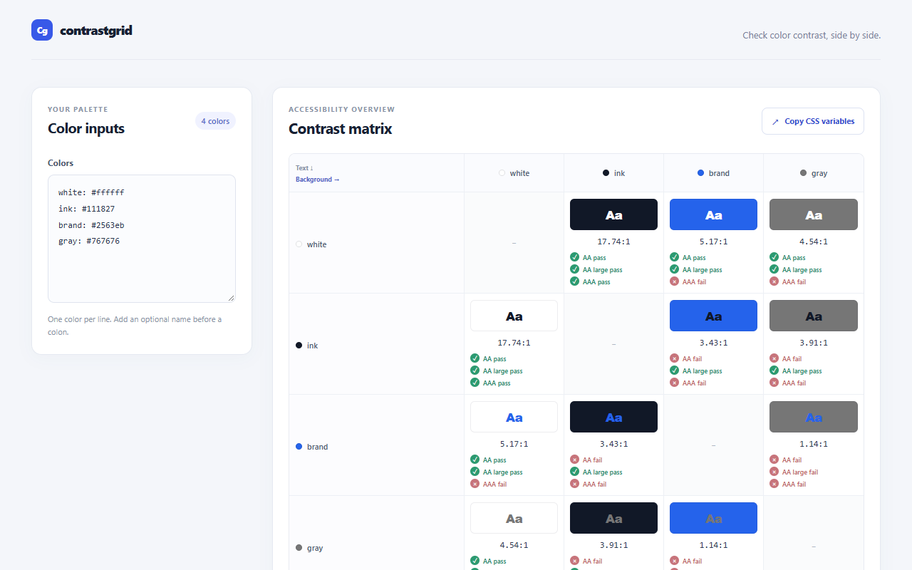

<p align="center"></p>

# contrastgrid

contrastgrid is an offline color-contrast checker for designers and front-end developers. Paste a set of named or unnamed colors to see WCAG contrast ratios for every text/background combination, with AA, AA large, and AAA pass/fail results. It runs locally and makes no network calls.

[](https://github.com/Gulliby-development/contrastgrid/actions/workflows/ci.yml) [](LICENSE)



## Install and run

Requirements: [Bun](https://bun.sh/).

```sh
bun install
bun run dev
```

Open the local URL printed by Vite. The default list is:

```text
white: #ffffff
ink: #111827
brand: #2563eb
gray: #767676
```

Edit the **Colors** field to replace the list. The matrix uses each color as text against every color as a background; diagonal comparisons are shown as `-`. A pair summary above the matrix shows the contrast tally; the default palette displays `6 pairs: 3 pass AA, 2 pass AA large only, 1 fail`. Invalid lines and duplicate names are reported below the field while valid colors remain in the matrix. Use **Copy CSS variables** to copy variables for the valid colors.

## Accepted input

Enter one color per line. A name is optional and precedes the first colon:

```text
Brand Blue: #2563eb
ink: rgb(17, 24, 39)
#767676
```

Supported formats are `#rgb`, `#rrggbb` (case-insensitive), and `rgb(r, g, b)` with integer channels from 0 to 255. The `rgb` keyword is case-insensitive; spaces around numbers and commas are optional. Blank lines are ignored. Unnamed colors use their lowercase hex value as their name. Names are compared case-insensitively, and later duplicates are ignored with an error message.

## WCAG ratings

The matrix calculates WCAG 2.x contrast ratios and rates the unrounded ratio:

- **AA:** at least 4.5:1 for normal text.
- **AA large:** at least 3:1.
- **AAA:** at least 7:1 for normal text.

Reference values:

| Text color on white | Ratio | Result |
| --- | ---: | --- |
| `#000000` | 21.00:1 | — |
| `#767676` | 4.54:1 | AA passes |
| `#777777` | 4.48:1 | AA fails; AA large passes |
| `#2563eb` | 5.17:1 | — |
| `#111827` | 17.74:1 | — |

## Development

Install dependencies with `bun install`, then type-check and lint with `bun run typecheck` and `bun run lint`. Create a production build with:

```sh
bun run build
```

Run the automated tests with:

```sh
bun test
```

The tests cover color parsing, WCAG calculations and thresholds, input errors, grid and CSS-variable output, and server-rendered default application markup.

## License

MIT, see [LICENSE](LICENSE).

---

Built with BAKED, an open-source coding agent (bench loop round 5, BAKED f207b8b).
